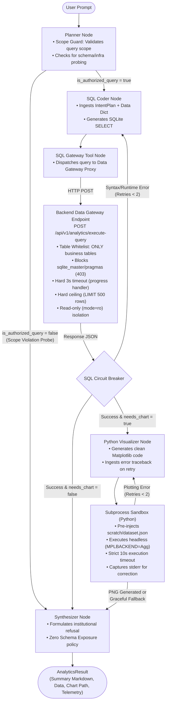
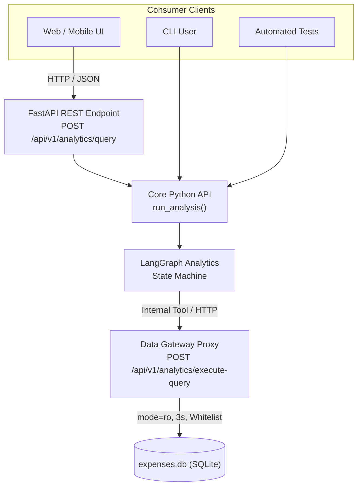

# Technical Handoff Document: Phase 3 Analytics & Plotting Graph

## 1. Executive Summary & Objective

This document formalizes the architectural agreement and technical specifications for **Phase 3: Analytics & Plotting Graph** of the Chilean Building Expense Data Analyst Agent (*"Gastos Comunes"*).

* **Primary Objective:** Construct an autonomous, deterministic, self-healing **LangGraph state machine** capable of answering complex analytical questions about building expenses and producing visual charts (e.g., trends, category distributions, anomaly comparisons).
* **Target Database:** Local SQLite database (`data/storage/expenses.db`) in WAL mode, currently populated with 15 historic monthly reports, 118 categorical sections, and 488 line items.
* **Core Security Architecture:** To adhere strictly to enterprise production standards:
  1. **Zero Direct DB Access for Agent:** The AI agent never directly opens the SQLite database file. All SQL execution is mediated through an isolated **Data Gateway Proxy** (`POST /api/v1/analytics/execute-query`).
  2. **Infrastructure Privacy & Anti-Introspection:** The system operates strictly on row-level business data and is **strictly prohibited from disclosing schema metadata, table names, column names, or database architecture**.
  3. **3-Layer Defense Guardrails:** Dual-gate security enforcing Scope Guarding in the Planner, strict Table Whitelisting in the Data Gateway, and Zero-Schema terminology masking in the Synthesizer.
* **Relationship to Overall Roadmap:**
  * **Phase 1 (Complete):** Multimodal PDF extraction and self-healing validation pipeline (`data_extractor/`).
  * **Phase 2 (Complete):** Persistence storage layer and FastAPI REST synchronization (`backend/`).
  * **Phase 3 (Current):** Dedicated Analysis & Plotting Graph (`analytics/`), integrated with the backend Data Gateway, exposed via Python API, CLI, and FastAPI.
  * **Phase 4 (Future):** Top-level Conversational Supervisor Agent (`agent/`), managing multi-turn chat memory, loader tools, system utility health checks, and delegating analytical queries to this Phase 3 graph.

---

## 2. Business Context & Strategic Requirements

### 2.1 Domain Realities (Chilean Building Expenses)
1. **Deterministic Calculations:** As mandated by [`AGENTS.md`](../AGENTS.md), **LLMs must never perform arithmetic or calculate sums**. All aggregations, percentages, and difference calculations are executed by SQLite or deterministic Python code.
2. **Integer Currency:** All Chilean Peso (CLP) values are represented as integers (no decimal cents).
3. **Standardized Periods:** Billing periods follow the `YYYY-MM-01` date format in `expense_reports.period_date`, with explicit indexed columns `period_year` and `period_month`.
4. **Credit Notes:** Negative numbers are valid line item amounts in `expense_items` representing discounts or refunds.

### 2.2 Future Extensibility (Unit-Level Expenses & Tenancy)
A core rationale driving this architecture is the upcoming expansion to **individual apartment units** (`unit_expenses`, tracking individual water meters, building infractions, parking/cellar surcharges, and reserve fund quotas).
* Ambiguous questions such as *"Why are my gastos comunes so expensive this month?"* require **intent decomposition**:
  * Is it an apartment-specific surge (e.g. heating/hot water spikes, fines)?
  * Or a building-wide surge (e.g. boiler maintenance, annual insurance renewals)?
* A dedicated **Planner Node** is therefore required to dissect the business intent, select the appropriate database entities, formulate an investigative strategy, and determine if visual charting is required before generating SQL.
* The **Data Gateway Proxy** provides the future enforcement hook to ensure tenant row-level security (e.g. preventing tenant 101 from querying tenant 402's hot water consumption).

### 2.3 Strict Data Governance: Zero Schema & Infrastructure Leakage
* **Policy Mandate:** End-users are business stakeholders and tenants. They must **never** be exposed to database infrastructure, table names, column schemas, SQL syntax, or database dialect details.
* **Prohibited Queries:** Questions that request schema introspection (e.g., *"¿Cuál es la tabla que almacena las mantenciones?"*, *"Dime las columnas de la base de datos"*, or *"Muéstrame el esquema de SQLite"*) are classified as **out-of-scope / unauthorized probes**.
* **Mandatory Behavior:** The system must refuse to disclose technical architecture or table names, refusing the query politely and explaining that it only performs row-level financial and expense reporting.

---

## 3. System Architecture & Workflow Topology

### 3.1 LangGraph State Machine & Data Gateway Workflow



### 3.2 Detailed Node & Component Specifications

| Component Name | Type | Responsibilities & Circuit Breakers |
| :--- | :--- | :--- |
| **`planner`** | LLM (`google.genai`) | **Scope Guard:** Checks if query attempts schema/infrastructure probing. If unauthorized, sets `is_authorized_query=False` and provides `refusal_reason`. If authorized, determines target tables, time horizon, analytical goal, and whether a chart is required. |
| **`sql_coder`** | LLM (`google.genai`) | Translates `IntentPlan` and the YAML Data Dictionary into an accurate SQLite `SELECT` query. If retrying, consumes previous SQL error feedback. |
| **`sql_gateway_node`** | Tool / Client | Invokes the Data Gateway via HTTP or in-process client adapter. Receives query results or structured error payloads. Increments `retry_count` on failure. |
| **`Data Gateway Proxy`** | FastAPI Endpoint (`POST /api/v1/analytics/execute-query`) | 1. **Table Whitelist:** Whitelists ONLY `expense_reports`, `expense_sections`, `expense_items`. Strictly rejects `sqlite_master`, `sqlite_schema`, and `pragma_*` with HTTP 403 Forbidden.<br>2. **AST Gate:** Ensures query starts with `SELECT` or `WITH`; strictly rejects DML/DDL (`INSERT`, `UPDATE`, `DELETE`, `DROP`, `ALTER`, `ATTACH`).<br>3. **Engine Timeout:** Attaches `sqlite3.set_progress_handler` with 3-second hard ceiling to terminate infinite recursive CTEs or Cartesian joins.<br>4. **Row Ceiling:** Enforces mandatory query wrapping with `LIMIT 500`.<br>5. **Connection Isolation:** Connects strictly via `file:expenses.db?mode=ro`.<br>6. **Audit Logging:** Logs query string, caller, latency, and status code. |
| **`visualizer`** | LLM (`google.genai`) | Generates standalone Python Matplotlib script designed to read from `dataset.json` and save a clean chart to `output.png`. Ingests traceback stderr if retrying. |
| **`sandbox_runner`** | Isolated Subprocess | Executes the visualizer script in an isolated scratch directory via `python3 -u` with `MPLBACKEND=Agg` and a 10s timeout.<br>**Circuit Breaker:** If script fails after 2 retries, logs warning and falls back gracefully to tabular data without crashing the workflow. |
| **`synthesizer`** | LLM (`google.genai`) | **Zero Schema Exposure:** Translates findings strictly into Chilean building expense domain terms. If `is_authorized_query=False`, delivers institutional refusal without running SQL or leaking infrastructure. |

---

## 4. Gold-Standard Agent State Schema

```python
from __future__ import annotations

import operator
from typing import Annotated, Any, Literal, Optional, TypedDict
from langchain_core.messages import BaseMessage
from langgraph.graph.message import add_messages
from pydantic import BaseModel, Field


class ExecutionError(TypedDict):
    """Structured telemetry record of a node failure."""
    node: str
    error_message: str
    attempt: int


class IntentPlan(BaseModel):
    """Output contract for the Planner node, featuring Scope Guarding."""
    is_authorized_query: bool = Field(
        description="False if the query probes database infrastructure, table names, schema metadata, or credentials."
    )
    refusal_reason: Optional[str] = Field(
        default=None,
        description="Reason for refusal if is_authorized_query is False."
    )
    analysis_goal: str = Field(
        default="",
        description="Summary of the business question to solve (only populated if authorized)."
    )
    relevant_tables: list[str] = Field(
        default_factory=list,
        description="Tables required (e.g. ['expense_reports', 'expense_sections'])"
    )
    time_scope: str = Field(
        default="",
        description="Time horizon (e.g. 'all periods', '2026', '2025-06-01 to 2026-06-01')"
    )
    requires_visualization: bool = Field(
        default=False,
        description="True if a chart is needed or beneficial"
    )
    visualization_goal: Optional[str] = Field(
        default=None,
        description="What the chart should highlight"
    )
    suggested_chart_type: Optional[Literal["line", "bar", "pie", "stacked_bar"]] = Field(default=None)


class DataAnalystState(TypedDict):
    # 1. CONVERSATION TIER (Append-only reducer; enables Phase 4 multi-turn integration)
    messages: Annotated[list[BaseMessage], add_messages]

    # 2. OPERATIONAL TIER (Overwritten per pass)
    user_query: str                          # Raw input query
    intent_plan: Optional[IntentPlan]        # Structured plan from planner
    current_sql: Optional[str]               # Active SQL query
    sql_results: Optional[list[dict[str, Any]]] # Fetched database records from Data Gateway
    visualization_code: Optional[str]        # Generated Matplotlib script
    chart_file_path: Optional[str]           # Path to rendered PNG chart
    final_markdown: Optional[str]            # Final textual summary

    # 3. CONTROL & SAFETY TIER (Circuit breakers & retry routing)
    retry_count: int                         # Active retry counter
    max_retries: int                         # Maximum allowed self-healing attempts (default: 2)
    error_history: Annotated[list[ExecutionError], operator.add]
```

---

## 5. Security & Isolation Model (The 3-Layer Defense)

### 5.1 Layer 1: Scope Guarding in the Planner
* The `planner` evaluates if the incoming request asks about infrastructure, database internal tables, schemas, or non-business operations.
* When a probe is detected (e.g. *"¿Cuál es la tabla que almacena esto?"*):
  - Sets `is_authorized_query = False`.
  - Sets `refusal_reason = "El usuario solicitó información sobre la arquitectura interna de tablas."`.
  - The conditional edge routes immediately to `synthesizer`, completely bypassing SQL generation and execution.

### 5.2 Layer 2: Strict Table Whitelisting in Data Gateway Proxy (HTTP 403)
Even if an adversarial query passes through or an LLM hallucination occurs, the Data Gateway Proxy strictly validates the SQL AST before touching SQLite:
* **Allowed Tables Whitelist:** ONLY `{'expense_reports', 'expense_sections', 'expense_items'}` (plus future `{'unit_expenses'}`).
* **Prohibited Introspection Targets:** References to `sqlite_master`, `sqlite_schema`, `sqlite_temp_master`, `pragma_*`, or unauthorized names immediately raise **HTTP 403 Forbidden**.
* **Progress Handler Timeout:** `sqlite3.set_progress_handler` cancels runaway recursive CTEs or Cartesian joins after 3 seconds.
* **Mandatory Row Cap:** All results are capped at 500 rows.

### 5.3 Layer 3: Zero Schema Exposure in Synthesizer
* The system prompt for `synthesizer` strictly prohibits technical jargon and database metadata.
* Database identifiers like `expense_sections`, `report_id`, `UUIDv7`, or `SQL query` are masked.
* All findings are expressed in domain terminology (*"Categoría Mantenciones y Servicios"*, *"Período de Facturación"*, *"Monto Facturado en CLP"*).
* If `is_authorized_query == False`, the Synthesizer outputs a standardized, polite refusal:
  > *"Este sistema está configurado exclusivamente para realizar análisis financieros y reportería sobre los gastos comunes del edificio a nivel de datos. Por políticas de seguridad y gobernanza, no está autorizado a divulgar información sobre la arquitectura, nombres de tablas ni infraestructura de la base de datos."*

### 5.4 Subprocess Sandbox for Python Visualization
* Visualization code is never executed via `exec()` or `eval()` inside the main process.
* Execution is sandboxed in a separate OS process via `python3 -u` with `MPLBACKEND=Agg` and a 10-second timeout.
* Input data is passed as a sanitized JSON file (`scratch/dataset.json`), completely insulating the database from generated code.

---

## 6. Access Interface: 3-Tier Pattern



1. **High-Level Consumer API (`POST /api/v1/analytics/query`):**
   * Request Body: `{"query": str, "include_chart": bool}`
   * Executes the full LangGraph state machine and returns `{summary, sql_query, data, chart_url, telemetry}`.
2. **Data Gateway Proxy Endpoint (`POST /api/v1/analytics/execute-query`):**
   * Request Body: `{"sql": str, "timeout_seconds": 3.0, "max_rows": 500}`
   * Validates Table Whitelist, enforces read-only mode and 3s progress timeout. Returns `{columns, rows, row_count, execution_time_ms}` or HTTP 400/403/408.
3. **CLI Entry Point (`analytics/cli.py`):**
   ```bash
   python -m analytics.cli "Compare administration vs maintenance expenses in 2026" --output-chart
   ```
4. **Core Python API (`analytics.workflow.run_analysis`):**
   * Allows running queries directly from tests or Phase 4 agent using either an HTTP client or an in-process adapter against the Gateway.

---

## 7. Package Layout (`analytics/` & `backend/`)

```
analytics/
├── __init__.py
├── config.py              # Operational settings (gateway URLs, timeouts, default models)
├── state.py               # DataAnalystState, IntentPlan, ExecutionError, AnalyticsResult
├── gateway_client.py      # HTTP / in-process client adapter for Data Gateway Proxy
├── sandbox.py             # Subprocess execution sandbox for Matplotlib
├── prompt_loader.py       # Prompt templates & YAML Data Dictionary loader
├── workflow.py            # LangGraph StateGraph assembly and run_analysis()
├── cli.py                 # Terminal CLI interface
└── prompts/
    ├── data_dictionary.yaml   # 3-table schema, sample values & business rules
    ├── planner_system.txt     # System prompt for IntentPlan & Scope Guard
    ├── sql_coder_system.txt   # System prompt for SQL generation
    ├── visualizer_system.txt  # System prompt for Matplotlib generation
    └── synthesizer_system.txt # System prompt for final markdown response & Zero Schema policy

backend/app/routes/
├── analytics.py           # Exposes /execute-query (Gateway Proxy) and /query (Consumer)
```

---

## 8. Verification & Quality Gates

1. **Security & Scope Guard Unit Tests (`tests/test_analytics_scope_guard.py`):**
   * Test that probing queries (e.g. *"¿Cuál es la tabla que almacena esto?"*) set `is_authorized_query=False` and bypass SQL generation.
   * Test that synthesizer returns polite institutional refusal without naming tables or database technology.
2. **Data Gateway Unit Tests (`backend/tests/test_analytics_gateway.py`):**
   * Verify Table Whitelist blocks queries referencing `sqlite_master`, `sqlite_schema`, or `pragma_*` with HTTP 403 Forbidden.
   * Verify read-only enforcement (blocks `DROP`, `INSERT`, `UPDATE`, `ATTACH`).
   * Verify 3-second timeout cancels runaway recursive CTEs (`WITH RECURSIVE`).
   * Verify automatic row truncation at 500 rows.
3. **Sandbox Security Tests (`tests/test_analytics_sandbox.py`):**
   * Test successful PNG generation with headless backend.
   * Test timeout circuit breaker (infinite loops terminated at 10s).
   * Test stderr capture and retry formatting.
4. **Integration Tests (`tests/test_analytics_workflow.py`):**
   * End-to-end queries against `data/storage/expenses.db` (15 real monthly reports).
   * Verify self-healing retries on invalid SQL and graceful fallback on chart failure.
5. **Consumer Endpoint Test (`backend/tests/test_analytics_route.py`):**
   * Test `POST /api/v1/analytics/query` returns HTTP 200 with complete markdown and telemetry.

---

## 9. Next Steps for Implementation

1. **Propose OpenSpec Change:** Run `/openspec-propose` to generate standard design specifications, requirement deltas, and implementation task lists.
2. **Implementation Sequence:**
   1. Add `matplotlib` to `requirements.txt`.
   2. Implement the **Data Gateway Proxy** in `backend/app/routes/analytics.py` with Table Whitelisting, progress handler timeouts, and row caps.
   3. Create `analytics/` package with `config.py`, `state.py`, `gateway_client.py`, and `prompts/data_dictionary.yaml`.
   4. Implement `sandbox.py` (isolated subprocess runner).
   5. Implement LangGraph nodes (`planner` with Scope Guard, `sql_coder`, `sql_gateway_node`, `visualizer`, `synthesizer` with Zero Schema policy) and assemble `workflow.py`.
   6. Implement CLI (`analytics/cli.py`) and high-level query endpoint.
   7. Write unit, security guardrail, and integration test suites.
