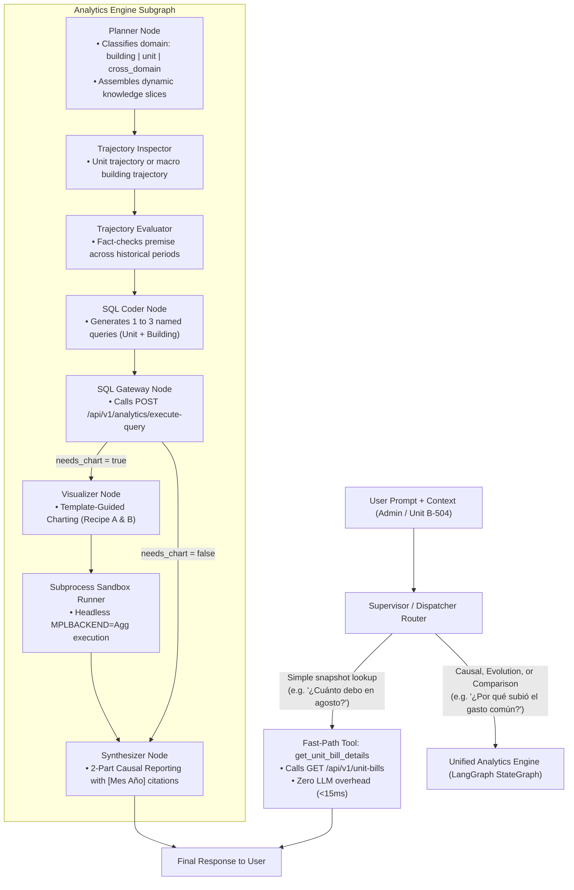

# Architecture Design: Micro (Unit-Level) & Macro (Building-Level) Analytics Integration

## 1. Executive Summary

This document specifies the technical design for adding **Unit-Level Expense Intelligence** (e.g., apartment `B-504` from [`examples/504b-2026-08.pdf`](file:///home/nereyes/agentes/data-analyst/examples/504b-2026-08.pdf)) and bridging it seamlessly with the existing **Macro Building-Level Analytics Engine** ([`analytics/`](file:///home/nereyes/agentes/data-analyst/analytics/)).

Currently, the backend persistence layer ([`backend/app/routes/analytics.py`](file:///home/nereyes/agentes/data-analyst/backend/app/routes/analytics.py#L19-L27)) and Data Gateway already support the 4 unit tables (`unit_bills`, `unit_bill_concepts`, `unit_bill_consumptions`, `unit_bill_charges`) alongside the 3 macro tables (`expense_reports`, `expense_sections`, `expense_items`). 

Rather than duplicating analytical logic across bespoke tools, the architecture adopts a **Two-Tier Hybrid Design**:
1. **Tier 1 (Fast-Path Tool):** A lightweight, non-LLM tool (`get_unit_bill_details`) calling `GET /api/v1/unit-bills` for instant (<15ms, zero token cost) snapshot queries.
2. **Tier 2 (Unified Analytics Engine):** Reuses the 9-node LangGraph state machine ([`analytics/workflow.py`](file:///home/nereyes/agentes/data-analyst/analytics/workflow.py)) for time-series evolution, multi-unit comparisons, and multi-part causal investigations, backed by a **Dynamic Modular Knowledge Base** and **Recipe-Driven Charting**.

---

## 2. Core Problem Decomposition: The Cross-Domain Bridge

When a resident receives their monthly bill (such as [`504b-2026-08.pdf`](file:///home/nereyes/agentes/data-analyst/examples/504b-2026-08.pdf)) and asks:
> *"¿Por qué subió tanto mi gasto común de agosto en el depto B-504?"*

The financial explanation inherently spans **two distinct causal parts**:

```
                            "¿Por qué subió mi gasto común en B-504?"
                                                │
                 ┌──────────────────────────────┴──────────────────────────────┐
                 ▼                                                             ▼
    PART 1: The Micro Delta (What changed?)                       PART 2: The Macro Cause (Why did it change?)
    ─────────────────────────────────────────                     ─────────────────────────────────────────────
    Querying: `unit_bills`, `unit_bill_concepts`,                 Querying: `expense_reports`, `expense_sections`,
              `unit_bill_consumptions`                                      `expense_items`
    
    1. Base Gasto Común went from $82K to $93K (+$11K)            1. Building operational total surged from $49M
    2. Hot water tariff went from $5.200 to $8.340/m³ (+$5K)         to $55.7M (+13.7%) due to elevator repairs.
    3. New surcharge: "Fondo Impermeabilización" (+$10K)             (Your 0.16736% alícuota directly absorbed this).
                                                                  2. Central boiler gas bill rose by 65% in August,
                                                                     driving up the shared m³ rate.
```

### Deterministic Financial & Schema Bridge

In Chilean Condominium Law (Ley 21.442), unit charges relate to macro expenses through strict deterministic relationships:

1. **Prorated Base Gasto Común:**
   $$\text{Base Gasto Común} = \text{ROUND}\left( \text{expense\_reports.operational\_total} \times \frac{\text{unit\_bills.alicuota\_total}}{100} \right)$$
   *Example from [`examples/504b-2026-08.pdf`](file:///home/nereyes/agentes/data-analyst/examples/504b-2026-08.pdf):*
   $$\text{ROUND}\left( 55.709.656 \times \frac{0.16736}{100} \right) = \$93.236 \text{ CLP}$$
2. **Central Boiler Metered Tariff (`unit_rate`):**
   The unit rate for hot water (`$8.340,24/m³` in `unit_bill_consumptions`) is derived by dividing total boiler fuel/gas expenses in `expense_items` by total community m³ consumed.
3. **Dedicated Fund Contributions:**
   Fund line items in `unit_bill_concepts` (e.g. `Fondo de Reserva 5%` = `$4.662`, `Fondo Impermeabilizacion` = `$10.878`) correlate with sections in `expense_sections` where `expense_type = 'fondos'`.

---

## 3. High-Level System Topology



---

## 4. Dynamic Modular Knowledge Base (Token Optimization)

To prevent inflating every SQL generation call with all 7 tables (~3,500+ tokens), the static `data_dictionary.md` is broken down into **4 composable modular slices**:

```
analytics/prompts/data_dictionary/
├── 00_core_conventions.md     (~250 tokens)
│   • Integer CLP currency rules, YYYY-MM-01 format, negative credit notes
├── 01_building_domain.md      (~1,200 tokens)
│   • expense_reports, expense_sections, expense_items
│   • Operational vs Fondos categories
├── 02_unit_domain.md          (~1,200 tokens)
│   • unit_bills, unit_bill_concepts, unit_bill_consumptions, unit_bill_charges
│   • Readings, meters, alícuotas
└── 03_cross_domain_bridge.md  (~400 tokens)
    • Prorating formulas: ROUND(operational_total * alicuota_total / 100)
    • Boiler gas expense -> unit_rate ($/m³) relationship
```

### Knowledge Injection Strategy
- **Pure Building Queries:** Loads `00_core` + `01_building` (saves ~1,600 tokens).
- **Pure Unit Queries:** Loads `00_core` + `02_unit` (saves ~1,600 tokens).
- **Cross-Domain Causal Queries:** Loads all 4 slices for complete multi-table reasoning.

---

## 5. Recipe-Driven Charting (Strategy 3)

Unit data presents severe scale discrepancies (e.g., $108.776 CLP total bill vs. 1.7013 m³ water volume vs. $8.340/m³ tariff). To avoid LLM dual-axis hallucinations, [`analytics/prompts/visualizer_system.md`](file:///home/nereyes/agentes/data-analyst/analytics/prompts/visualizer_system.md) embeds **two battle-tested visual recipes**:

### Recipe A: `unit_stacked_evolution` (Stacked Component Evolution)
- **Goal:** Disentangles base prorating, variable utility consumption, and special fund quotas.
- **Visual:** Monthly stacked bars (`bottom=...`) separating Base Gasto Común, Consumos, and Fondos/Recargos with total CLP labels on top.

### Recipe B: `dual_axis_tariff` (Tariff vs. Volume Disentangler)
- **Goal:** Disentangles shower habits (m³) from heating cost surges ($/m³).
- **Visual:** Dual Y-axis (`ax.twinx()`) pairing subtle volume bars on the left axis with an orange tariff line and annotated markers on the right axis.

---

## 6. Role Model & Cross-Unit Comparisons

1. **Role Configuration (Admin by Default):**
   - The system is configured for an **Admin / Property Manager** role by default.
   - Any `unit_code` can be queried or filtered.
   - Future **Resident** mode will automatically bind `unit_code` from user session tokens to prevent unauthorized cross-unit inspection.
2. **Native Multi-Unit Comparisons:**
   - Multi-unit queries (e.g., comparing `B-504` vs. `B-506`) do not require specialized Python tools.
   - The Planner classifies them as `comparative_cohort`, and `sql_coder` generates native `WHERE unit_code IN ('B-504', 'B-506')` queries.

---

## 7. Fast-Path Tool Specification: `get_unit_bill_details`

- **Purpose:** Answers direct snapshot questions (*"¿Cuánto debo pagar este mes en el 504B?"*, *"¿Qué cobros incluye mi boleta de agosto?"*) without graph overhead.
- **Signature:**
  ```python
  def get_unit_bill_details(
      unit_code: str,
      period_date: str | None = None,  # e.g. "2026-08-01"; if None, fetches latest
  ) -> dict[str, Any]:
  ```
- **Transport:** HTTP `GET /api/v1/unit-bills?unit_code={unit_code}` mediated by `httpx.Client`.
- **Response Payload:** Compact domain JSON containing `unit_code`, `period_date`, `calculated_total_month`, `last_payment_date`, `concepts`, `consumptions`, and `unit_charges`.
